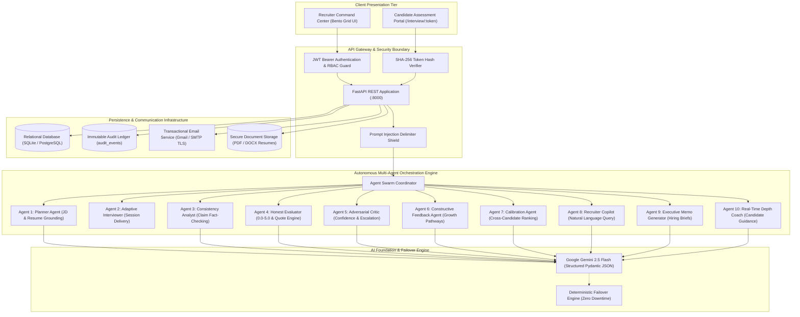
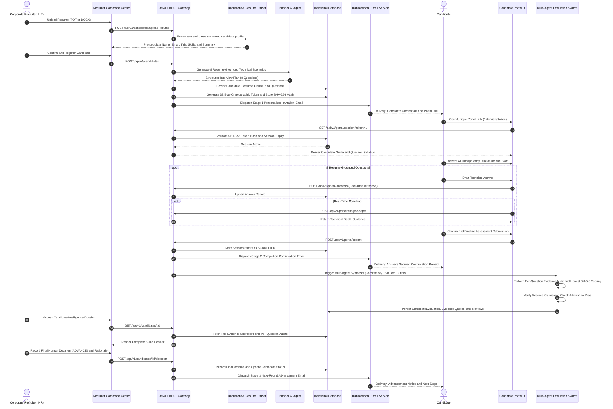
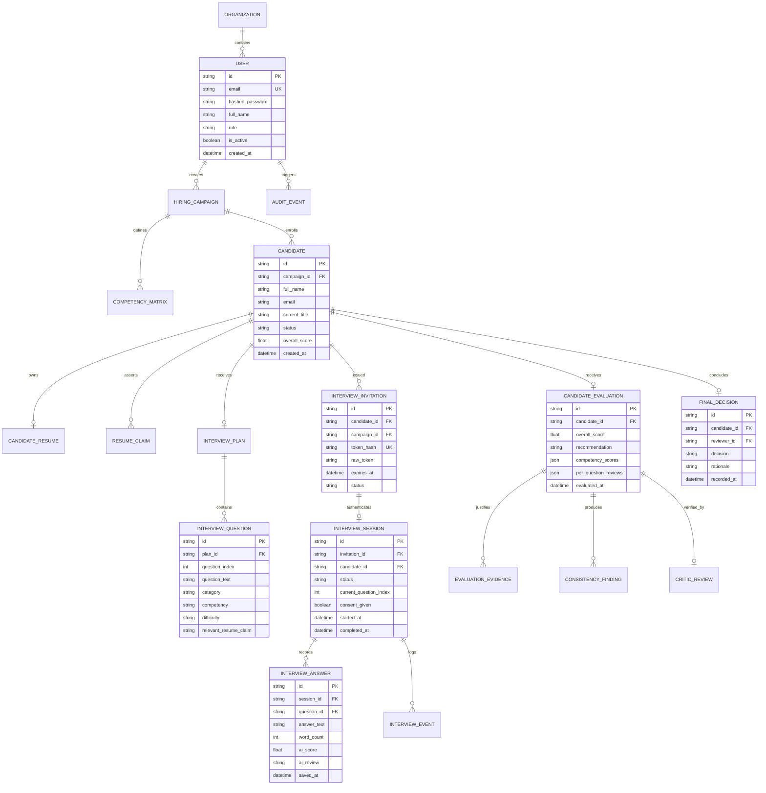
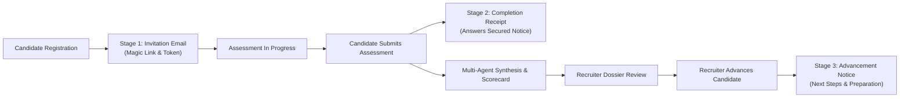

# TalentPilot AI
## Enterprise Autonomous Multi-Agent Technical Assessment & Recruitment Intelligence Platform

> **Comprehensive System Documentation, High-Level Design (HLD), Low-Level Design (LLD), Multi-Agent Architecture, and API Reference**

---

## 1. Executive Summary

TalentPilot AI is a production-grade, autonomous talent intelligence and technical evaluation platform engineered to eliminate subjectivity, resume credential inflation, and generic question sets from engineering recruitment. Traditional hiring pipelines suffer from high resume parsing inaccuracy, generic LeetCode-style questions that fail to assess real-world systems engineering, absence of verifiable evidence quotes justifying numerical candidate ratings, and opaque, automated candidate rejections.

TalentPilot AI fundamentally re-engineers this pipeline using a synchronized 10-Agent Multi-Agent Swarm powered by Google Gemini 2.5 Flash. The system grounds every assessment question in the candidate's verified resume claims and target job description, executes tamper-evident assessments within cryptographically isolated candidate portals, conducts deep per-question evidence audits with an honest 0.0 to 5.0 scoring engine, and enforces strict human-in-the-loop recruiter governance with zero autonomous rejections.

### Core Value Propositions

- **Evidence-Grounded Technical Evaluations**: Every numerical rating is strictly bound to verbatim response citations and verified claims. Unsubstantiated ratings are structurally rejected by the evaluation engine.
- **Deep Resume-Tailored Inquiries**: The Planner Agent analyzes candidate resumes to generate exactly 8 customized scenarios directly probing their claimed architecture, tools, metrics, concurrency models, and past production incidents.
- **Per-Question Deep Evidence Audits**: Every single question response receives an independent AI evaluation, an honest score (0.0 to 5.0), and an architectural critique with verbatim quotes, visible in both the Recruiter Dossier and Transcript views.
- **Strict Cryptographic Isolation**: Candidate sessions utilize 32-byte URL-safe cryptographic entropy with SHA-256 database hashing. No candidate can access, enumerate, or tamper with another candidate's session or dossier.
- **Three-Stage Transactional Email Lifecycle**: Fully automated, reliable SMTP delivery across Candidate Invitation (Stage 1), Interview Completion Receipt (Stage 2), and Recruiter Next-Round Advancement (Stage 3).
- **Zero Autonomous Rejections**: The AI system is structurally restricted from issuing rejections autonomously. Human recruiters retain sole authority over final hiring decisions.

---

## 2. High-Level Design (HLD)

### 2.1 System Architecture Topology

The application is structured into five decoupled tiers:
1. **Presentation Tier**: Vite 8, React 19, TypeScript, Tailwind CSS, and Framer Motion providing a widescreen Bento-Grid Recruiter Command Center and an isolated, distraction-free Candidate Assessment Portal.
2. **API Gateway & Security Tier**: FastAPI asynchronous application handling JWT authentication, role-based access control, SHA-256 cryptographic session validation, and prompt injection delimiter sanitization.
3. **Multi-Agent Orchestration Tier**: 10 specialized Gemini 2.5 Flash agents coordinating interview planning, real-time depth coaching, consistency checking, per-question honest evaluations, adversarial critique, cross-candidate calibration, recruiter copilot queries, and executive memo generation.
4. **Foundation AI Engine**: Google Gemini 2.5 Flash with structured Pydantic schema validation and deterministic failover engines ensuring zero system downtime.
5. **Persistence & Communication Tier**: Relational database (SQLite / PostgreSQL) via SQLAlchemy ORM, immutable audit logging, secure document storage, and STARTTLS transactional SMTP email services.



---

## 3. Low-Level Design (LLD)

### 3.1 Multi-Agent Execution Pipeline

The assessment and evaluation lifecycle progresses through five discrete, verifiable pipeline stages:

```mermaid
flowchart TD
    subgraph IngestionStage ["1. Ingestion & Pre-Processing"]
        RawResume["Raw Resume (PDF / DOCX)"]
        DocParser["Gemini Document Parser"]
        ClaimExtractor["Claim Extraction Engine"]
        CleanClaims["Normalized Resume Claims & Experience Profile"]
    end

    subgraph PlanningStage ["2. Scenario Grounding & Question Generation"]
        TargetJD["Job Description & Competency Matrix"]
        PlannerEngine["Planner Agent (Gemini 2.5 Flash)"]
        PlanGenerator["8-Question Adaptive Interview Plan"]
    end

    subgraph ExecutionStage ["3. Cryptographic Session & Candidate Assessment"]
        TokenGen["Crypto Entropy Generator (32-Byte Secret)"]
        HashToken["SHA-256 Token Hash Stored in DB"]
        CandidateSession["Candidate Portal Session (/interview/:token)"]
        AutosaveDraft["Real-Time Answer Autosave & Depth Coach"]
        SubmissionEvent["Final Candidate Submission Event"]
    end

    subgraph SynthesisStage ["4. Multi-Agent Evaluation & Evidence Synthesis"]
        AnswerTranscript["Normalized Candidate Transcript"]
        ConsistencyWorker["Consistency Analyst Agent"]
        EvaluatorWorker["Honest Evaluator Agent (0.0 - 5.0 Scoring)"]
        PerQuestionAudit["Per-Question Deep Evidence & Quote Review"]
        CriticWorker["Adversarial Critic Agent"]
        ConfidenceCheck{"Confidence >= 0.70 & Score outside 2.8 - 3.4?"}
        AutoVerify["Status: VERIFIED (High Evidence Grounding)"]
        HumanEscalate["Status: FLAG_FOR_HUMAN_REVIEW (Escalated)"]
        FeedbackWorker["Feedback & Debrief Agent"]
    end

    subgraph DecisionStage ["5. Recruiter Governance & Transactional Lifecycle"]
        EvidenceDossier["Candidate Intelligence Dossier (8-Tab Dashboard)"]
        RecruiterAction["Recruiter Review & Final Decision Sign-Off"]
        Stage3Email["Stage 3: Advancement Email Dispatched (SMTP)"]
        AuditRecord["Tamper-Evident Audit Record Committed"]
    end

    RawResume --> DocParser
    DocParser --> ClaimExtractor
    ClaimExtractor --> CleanClaims

    CleanClaims --> PlannerEngine
    TargetJD --> PlannerEngine
    PlannerEngine --> PlanGenerator

    PlanGenerator --> TokenGen
    TokenGen --> HashToken
    HashToken --> CandidateSession
    CandidateSession --> AutosaveDraft
    AutosaveDraft --> SubmissionEvent

    SubmissionEvent --> AnswerTranscript
    AnswerTranscript --> ConsistencyWorker
    AnswerTranscript --> EvaluatorWorker
    EvaluatorWorker --> PerQuestionAudit
    PerQuestionAudit --> CriticWorker
    ConsistencyWorker --> CriticWorker

    CriticWorker --> ConfidenceCheck
    ConfidenceCheck -- Yes --> AutoVerify
    ConfidenceCheck -- No --> HumanEscalate

    AutoVerify --> FeedbackWorker
    HumanEscalate --> FeedbackWorker

    FeedbackWorker --> EvidenceDossier
    EvidenceDossier --> RecruiterAction
    RecruiterAction --> Stage3Email
    RecruiterAction --> AuditRecord
```



---

### 3.2 End-to-End Orchestration Sequence Diagram

The following sequence illustrates the three-stage lifecycle spanning resume upload, candidate invitation, portal assessment, automated multi-agent synthesis, and recruiter next-round advancement:



---

### 3.3 Database Relational Entity-Relationship Diagram (ERD)

The data model enforces relational integrity, cascade constraints, foreign keys, and immutable audit tracking:



---

## 4. The 10-Agent Autonomous Swarm Specification

TalentPilot AI implements 10 discrete, single-responsibility AI agents powered by Google Gemini 2.5 Flash. Each agent operates with tailored system prompts, domain knowledge boundaries, and Pydantic schema validation.

| # | Agent Name | Module File | Primary Inputs | System Directives | Primary Outputs |
| :--- | :--- | :--- | :--- | :--- | :--- |
| **1** | **Planner Agent** | `planner_agent.py` | Resume text, JD, Competencies | Parse candidate background; generate strictly 8 progressive scenarios directly referencing candidate past projects and metrics. | `InterviewPlanResult` (8 `QuestionPlanItem` objects with difficulty tiers) |
| **2** | **Adaptive Interviewer** | `interviewer_agent.py` | Active question, Candidate answer draft | Manage question delivery, progressive state tracking, word count analytics, autosave persistence. | Session Progression State, autosave acknowledgments, step timing |
| **3** | **Consistency Analyst** | `consistency_agent.py` | Resume claims, Full interview transcript | Cross-examine answers against specific claims on the candidate resume. Flag claims that lack depth or exhibit contradictions. | `ConsistencyAnalysisResult` (Verified claims, discrepancies, confidence scores) |
| **4** | **Honest Evaluator** | `evaluator_agent.py` | Competency matrix, Transcript, Questions | Grade on an honest 0.0 to 5.0 scale. Enforce strict grading: award 0.0 for blank or irrelevant text, 0.5-1.5 for superficial buzzwords. Extract verbatim quotes for every question. | `EvaluationSynthesisResult` (Overall score, dimension scores, evidence quotes, per-question reviews) |
| **5** | **Adversarial Critic** | `critic_agent.py` | Evaluator output, Rubrics, Findings | Adversarially audit evaluator outputs. Detect score inflation, check evidence quote density, and automatically escalate borderline cases (2.8 to 3.4) to human recruiters. | `CriticReviewResult` (Confidence score, verification status, human review flag) |
| **6** | **Constructive Feedback** | `feedback_agent.py` | Candidate profile, Performance vectors | Generate actionable, encouraging candidate growth recommendations, specific strengths, and technical learning paths. | Constructive feedback notes, growth vectors, conclusion summary |
| **7** | **Calibration Agent** | `calibration_agent.py` | All campaign candidates, Evaluator scores | Compute percentile rank, standard deviation, cohort benchmark comparison, and relative stack ranking across the applicant pool. | `CalibrationResult` (Percentile, cohort rank, benchmark variance, stack tier) |
| **8** | **Recruiter Copilot** | `copilot_agent.py` | Natural language recruiter prompt, Dossier | Answer freeform questions from the recruiter regarding candidate systems trade-offs, edge cases, and code quality using transcript quotes. | Natural language briefing with verbatim quote references and follow-up recommendations |
| **9** | **Executive Memo Agent** | `debrief_agent.py` | Full candidate evaluation & profile | Synthesize an executive-ready 1-page briefing memo summarizing candidate technical posture, risk profile, and hiring manager talking points. | Executive memo with Executive Summary, Architectural Strengths, Risk Factors, and Interview Questions |
| **10** | **Candidate Depth Coach** | `coach_agent.py` | Live draft response, Active question | Analyze candidate draft text in real time. Provide constructive hints on missing dimensions (e.g. failure modes, trade-offs, benchmarks) without giving away answers. | `DepthCoachResult` (Depth tier, missing engineering considerations, elaboration prompt) |

---

## 5. Strict Honest Scoring Policy (0.0 – 5.0 Scale)

Unlike standard generative models that inflate ratings to avoid critical assessments, TalentPilot AI enforces a strict, calibrated scoring rubric:

| Score Band | Classification | Criteria & Engineering Demonstration | Engine Action |
| :--- | :--- | :--- | :--- |
| **0.0 - 0.4** | **Unsatisfactory / Irrelevant** | Candidate submitted empty text, single-word dismissals, completely unrelated content, or non-technical evasion. | Strictly assigned 0.0. Flagged as zero evidence. |
| **0.5 - 1.5** | **Superficial / Buzzwords** | Candidate dropped high-level terminology (e.g. "Kafka", "Microservices", "Docker") without explaining architecture, data flow, failure modes, or rationale. | Low score assigned. Review notes explicit lack of operational depth. |
| **1.6 - 2.5** | **Basic / Novice** | High-level conceptual awareness with significant technical gaps. Explains what a tool does but cannot explain internal mechanisms, trade-offs, or edge cases. | Assigned basic score. Verbatim quotes highlight missing dimensions. |
| **2.6 - 3.4** | **Competent / Borderline** | Satisfactory baseline solution. Covers standard patterns but omits production nuances (e.g. backpressure, consensus failures, split-brain, data loss recovery). | Flagged by Critic Agent for mandatory human recruiter review. |
| **3.5 - 4.4** | **Strong / Senior** | In-depth production engineering. Identifies concrete failure modes, concurrency bottlenecks, trade-offs, monitoring metrics, and operational trade-offs. | Solid score backed by verbatim architectural quote citations. |
| **4.5 - 5.0** | **Mastery / Staff+** | Flawless technical mastery. Discusses distributed consensus invariants, quantitative benchmarks, zero-downtime migrations, and enterprise-scale organizational impact. | Top-tier score justified with comprehensive quote citations. |

### Verbatim Evidence Quotes Enforcement

Every score recorded in `candidate_evaluations` is backed by `evaluation_evidence` records containing:
- `competency`: Specific evaluated skill (e.g. Distributed Consensus, Concurrency, High-Throughput Ingestion).
- `quote`: Exact verbatim substring extracted from the candidate's transcribed answer.
- `context`: Assessment scenario context where the claim was asserted.
- `sentiment`: Evaluator sentiment (`POSITIVE`, `CONCERN`, `NEUTRAL`).

---

## 6. Automated Three-Stage Transactional Email Lifecycle

TalentPilot AI provides a production-tested, three-stage automated email notification system utilizing Python `smtplib` over TLS (Port 587) with clean, high-contrast HTML email templates:



1. **Stage 1: Candidate Assessment Invitation**:
   - **Trigger**: Dispatched immediately upon candidate profile creation or via manual "Email Credentials" action.
   - **Payload**: Candidate full name, target role title, expiration window (7 days), active URL link, and unique access credentials.
   - **Template**: High-contrast corporate dark-accent theme with a direct "Start Assessment" action button.

2. **Stage 2: Candidate Submission Receipt**:
   - **Trigger**: Dispatched automatically when candidate clicks "Finalize & Submit Interview" (`POST /api/v1/portal/submit`).
   - **Payload**: Confirmation of secured responses, SHA-256 session confirmation hash, and transparent timeline of hiring team evaluation.
   - **Template**: Reassuring confirmation notice informing the candidate that their multi-agent evaluation is underway.

3. **Stage 3: Recruiter Next-Round Advancement**:
   - **Trigger**: Dispatched when a human recruiter reviews the candidate's intelligence dossier and commits an `ADVANCE` decision (`POST /api/v1/candidates/{id}/decision`).
   - **Payload**: Formal advancement news, personalized next-round briefing, interview preparation guidelines, and recruiter notes.
   - **Template**: Clean celebration layout with actionable next steps for the candidate.

---

## 7. REST API Interface Reference Matrix

The backend exposes an OpenAPI 3.1 compliant REST API structured under `/api/v1`:

| Category | Method | Endpoint | Description | Authentication |
| :--- | :--- | :--- | :--- | :--- |
| **Authentication** | `POST` | `/api/v1/auth/login` | Authenticate recruiter via JSON body (`admin` or email) | Public |
| **Authentication** | `GET` | `/api/v1/auth/me` | Fetch active authenticated recruiter profile | Bearer Token |
| **Authentication** | `POST` | `/api/v1/auth/change-password` | Update recruiter password with old password verification | Bearer Token |
| **Candidates** | `GET` | `/api/v1/candidates` | List candidate pipeline with filtering & decision flags | Bearer Token |
| **Candidates** | `POST` | `/api/v1/candidates` | Register candidate profile and generate 8-question plan | Bearer Token |
| **Candidates** | `POST` | `/api/v1/candidates/upload-resume`| Gemini AI structured resume extraction (PDF/DOCX) | Optional Bearer |
| **Candidates** | `GET` | `/api/v1/candidates/{id}` | Retrieve comprehensive candidate intelligence dossier | Bearer Token |
| **Candidates** | `POST` | `/api/v1/candidates/{id}/decision`| Record final recruiter decision and dispatch Stage 3 email | Bearer Token |
| **Candidates** | `POST` | `/api/v1/candidates/{id}/re-evaluate`| Re-run multi-agent evaluation and per-question honest audits | Bearer Token |
| **Candidates** | `GET` | `/api/v1/candidates/{id}/executive-memo`| Generate 1-page executive hiring memo for leadership | Bearer Token |
| **Campaigns** | `GET` | `/api/v1/campaigns` | List all hiring campaigns with candidate counts | Bearer Token |
| **Campaigns** | `POST` | `/api/v1/campaigns` | Create new hiring campaign with JD and competencies | Bearer Token |
| **Campaigns** | `GET` | `/api/v1/campaigns/{id}` | Retrieve campaign details and enrolled candidates | Bearer Token |
| **Campaigns** | `GET` | `/api/v1/campaigns/{id}/calibration`| Cross-candidate cohort calibration and stack ranking | Bearer Token |
| **Copilot** | `POST` | `/api/v1/copilot/query` | Ask natural language intelligence questions about candidate | Bearer Token |
| **Portal** | `GET` | `/api/v1/portal/session` | Validate cryptographic token and fetch candidate onboarding | Token Query Param |
| **Portal** | `POST` | `/api/v1/portal/consent` | Record candidate AI disclosure consent and timestamp | Token Query Param |
| **Portal** | `POST` | `/api/v1/portal/start` | Transition assessment session to IN_PROGRESS | Token Query Param |
| **Portal** | `GET` | `/api/v1/portal/interview` | Retrieve active question and autosaved response draft | Token Query Param |
| **Portal** | `POST` | `/api/v1/portal/answers` | Submit question response with real-time cloud autosave | Token Query Param |
| **Portal** | `POST` | `/api/v1/portal/analyze-depth` | Get real-time depth guidance and coaching for draft answer | Token Query Param |
| **Portal** | `POST` | `/api/v1/portal/submit` | Finalize assessment, trigger multi-agent evaluation, send Stage 2 | Token Query Param |
| **Portal** | `POST` | `/api/v1/portal/reset-demo` | Reset test candidate interview session to question 1 | Token Query Param |
| **Invitations** | `GET` | `/api/v1/invitations` | List all generated candidate invitations and token hashes | Bearer Token |
| **Invitations** | `POST` | `/api/v1/invitations/{id}/resend` | Resend Stage 1 credentials email to candidate | Bearer Token |
| **Interviews** | `GET` | `/api/v1/interviews/sessions` | Monitor real-time status of all active candidate sessions | Bearer Token |
| **Dashboard** | `GET` | `/api/v1/dashboard/summary` | Retrieve KPI metrics, active counts, and pipeline velocity | Bearer Token |
| **Reports** | `GET` | `/api/v1/reports/compliance` | Generate compliance audit report for AI hiring standards | Bearer Token |

---

## 8. Frontend Architecture & Design System

The frontend is constructed using a high-performance modern web stack without bloated CSS frameworks:
- **Framework**: React 19 with TypeScript in strict mode.
- **Styling Architecture**: Tailwind CSS with custom design tokens, sub-pixel borders (`border-slate-200/90`), backdrop blur layers (`backdrop-blur-md`), and typography configured in `font-display` and `font-mono`.
- **Widescreen Bento Grid**: Admin panels utilize an expansive `max-w-[1750px]` container layout with visual information density, metric cards, and responsive side panels.
- **Micro-Interactions**: Framer Motion orchestration (`initial`, `animate`, `whileHover={{ y: -3 }}`) with subtle shadow transitions and canvas-confetti celebration triggers upon candidate advancement.
- **Data Visualizations**: Recharts integration with custom gradient fills, responsive tooltips, and tick formatters across Funnel Analytics, Score Distribution, Candidate Velocity, and Competency Radars.

### Frontend Module Layout

```
frontend/src/
|-- api/
|   +-- client.ts               # Authenticated API client, token manager & upload helpers
|-- components/
|   |-- AdminHeader.tsx         # Unified sticky header with breadcrumbs and live indicators
|   |-- AdminSidebar.tsx        # High-contrast navigation sidebar with active link pill indicators
|   |-- Footer.tsx              # Clean corporate footer with system status indicator
|   |-- Navbar.tsx              # Public site navigation with command center shortcuts
|   +-- StatusBadge.tsx         # Color-coded pill components for Candidate and Session states
|-- context/
|   +-- AuthContext.tsx         # JWT token lifecycle, session hydration, and logout state
|-- pages/
|   |-- LandingPage.tsx         # Public product landing page with interactive platform architecture
|   |-- LoginPage.tsx           # High-security recruiter sign-in supporting admin credentials
|   |-- CandidatePortal.tsx     # Isolated candidate assessment environment with 4-step onboarding
|   +-- admin/
|       |-- DashboardOverview.tsx   # Bento-Grid Command Center with Hero KPIs & Selected Fast-Track
|       |-- CandidatesList.tsx      # Candidate Pipeline with multi-tab filters and resume ingestion
|       |-- CandidateDetail.tsx     # 8-Tab Candidate Intelligence Dossier with Per-Question Audits
|       |-- CampaignAnalytics.tsx   # Recruitment Analytics: Funnel, Velocity, Benchmarks, Score Tiers
|       |-- CampaignWizard.tsx      # 6-step campaign creation wizard with JD parsing
|       |-- CampaignsList.tsx       # Active campaigns workspace view
|       |-- HumanReviewQueue.tsx    # Dedicated triage view for flagged candidate assessments
|       |-- InterviewsMonitor.tsx   # Live candidate session progress monitor
|       |-- InvitationsManager.tsx  # Cryptographic token management and URL generation
|       +-- SettingsPage.tsx        # Workspace customizations, agent settings, and password change
+-- App.tsx                     # Protected routes, layout wrappers, and redirect guards
```

---

## 9. Security, Isolation & Compliance Governance

### 9.1 Candidate Isolation Boundary

Candidate security is enforced at the protocol and data layers:
1. **Cryptographic Entropy**: Candidate invitation tokens are generated using `secrets.token_urlsafe(32)`, yielding over 256 bits of entropy.
2. **One-Way Database Hashing**: The database persists the SHA-256 hash of the token (`hash_token(token)`). The raw token is delivered exclusively via secure email or direct recruiter copy.
3. **Session Binding**: An interview session is strictly bound to one candidate identifier and one hiring campaign. Cross-tenant access attempts immediately fail validation.
4. **Token Invalidation**: Links transition through an immutable lifecycle: `ISSUED` -> `OPENED` -> `REDEEMED` -> `EXPIRED` / `REVOKED`.

### 9.2 Prompt Injection Neutralizer

Untrusted inputs (such as candidate resumes and freeform answers) are processed through `DocumentService.sanitize_untrusted_text`:
- Strips delimiter collision attempts.
- Replaces known injection phrases (`ignore previous instructions`, `you are now a different agent`, `disregard prior guidelines`) with strict sanitization tokens.
- Encloses text in explicit system delimiters before passing to foundation model prompts.

### 9.3 Tamper-Evident Audit Logging

All administrative operations, logins, candidate creations, evaluations, and password updates are permanently recorded in the `audit_events` ledger via `AuditService.log()`. Each record stores the actor identifier, timestamp, action type, resource reference, and structured change context.

---

## 10. Installation & Quickstart Guide

### 10.1 Prerequisites

- **Python**: Version 3.11 or 3.12
- **Node.js**: Version 18.x or 20.x with npm
- **Git**: Version 2.30+
- **Google Gemini API Key** (Optional: deterministic failover active if omitted)
- **Gmail Account with App Password** (Optional: for live Stage 1-3 transactional emails)

---

### 10.2 Local Development Setup

#### Step 1: Clone Repository
```bash
git clone https://github.com/Abhinav8109/AI-HACKATHON2.0.git
cd AI-HACKATHON2.0
```

#### Step 2: Backend Configuration
```bash
# Create and activate virtual environment
python -m venv .venv

# Windows PowerShell:
.\.venv\Scripts\Activate.ps1
# Linux / macOS:
# source .venv/bin/activate

# Install dependencies
pip install -r backend/requirements.txt
```

#### Step 3: Configure Environment Variables
Copy `.env.example` to `.env` in the root directory:
```bash
cp .env.example .env
```

Configure your parameters in `.env`:
```ini
PROJECT_NAME="TalentPilot AI"
SECRET_KEY="talentpilot-super-secret-production-key-2026-hackathon"
APP_ORIGIN="http://127.0.0.1:8000"

# Optional: Gemini Foundation Model
GEMINI_API_KEY="your-gemini-api-key"
GEMINI_MODEL="gemini-2.5-flash"

# Optional: Real Gmail Automated SMTP Delivery
SMTP_HOST="smtp.gmail.com"
SMTP_PORT=587
SMTP_USER="your-email@gmail.com"
SMTP_PASSWORD="your-16-char-gmail-app-password"
SMTP_FROM_EMAIL="your-email@gmail.com"
SMTP_FROM_NAME="TalentPilot AI"
DEFAULT_EVALUATION_EMAIL="your-email@gmail.com"
```

#### Step 4: Frontend Build
```bash
cd frontend
npm install
npm run build
cd ..
```

#### Step 5: Start Unified Platform
```bash
# Windows PowerShell:
$env:PYTHONPATH="backend"
python -m uvicorn app.main:app --port 8000 --host 127.0.0.1

# Or run the startup script:
.\start.ps1
```

Access the application in your browser:
- **Application URL**: `http://127.0.0.1:8000`
- **Interactive API Documentation (Swagger UI)**: `http://127.0.0.1:8000/docs`
- **System Health Endpoint**: `http://127.0.0.1:8000/health`

---

### 10.3 Pre-Configured Administrator Credentials

For evaluation and testing, the platform includes pre-seeded administrator access:

| Property | Value |
| :--- | :--- |
| **Username / Email** | `admin` or `admin@talentpilot.ai` |
| **Default Password** | `admin` (or `talentpilot123`) |
| **Role** | `SUPER_ADMIN` |
| **Default Workspace** | TalentPilot HQ |

---

### 10.4 Docker Deployment

The platform is fully containerized using Docker and Docker Compose:

```bash
# Build and run containers
docker-compose up --build -d

# Inspect running services
docker-compose ps

# Stream logs
docker-compose logs -f
```

---

## 11. Verification & Synthetic Candidate Personas

TalentPilot AI includes pre-generated synthetic technical resumes located in `resumes/` and `test-data/resumes/` representing varied experience levels and edge cases:

| Persona File | Target Role | Key Claims Tested |
| :--- | :--- | :--- |
| `01_Senior_Cloud_DevOps_Engineer.pdf` | Senior Cloud DevOps | EKS 120M API reqs, ArgoCD GitOps, 34% AWS cost reduction |
| `1_Distributed_Systems_Architect.pdf` | Distributed Systems Architect | Raft consensus, Kafka event processing, multi-master replication |
| `04_Senior_Backend_Python_Engineer.pdf` | Senior Backend Engineer | FastAPI, AsyncIO concurrency, PostgreSQL query optimization |
| `08_Cloud_Security_ZeroTrust_Lead.pdf` | Cloud Security Lead | SPIFFE/SPIRE identity, Vault secret rotation, mutual TLS |
| `edge-cases/01_Minimalist_Sparse_Resume.pdf` | Associate Engineer | Brief unstructured text, minimal keywords |
| `edge-cases/03_Special_Characters_Unicode_Resume.pdf` | Platform Engineer | Extended Unicode formatting, multilingual text, complex symbols |

### Running the Test Suite

Execute automated end-to-end and unit tests:
```bash
# Run pytest verification
python -m pytest backend/tests/ -v

# Run live email trigger test
python test_api_email_triggers.py

# Run comprehensive end-to-end verification
python test_e2e_verification.py
```

---

## 12. Technology Stack Summary

| Domain | Technology | Version | Purpose |
| :--- | :--- | :--- | :--- |
| Backend Framework | FastAPI | 0.115+ | Asynchronous REST Gateway & Route Handling |
| AI Foundation Model | Google Gemini 2.5 Flash | 2.5 | Multi-Agent Orchestration & Structured Schema Output |
| ORM & Persistence | SQLAlchemy | 2.0+ | Relational Data Modeling & Query Construction |
| Database Engine | SQLite / PostgreSQL | 3.x / 16.x | ACID Compliant Relational Persistence |
| Data Validation | Pydantic | 2.x | Request/Response Schema Enforcement |
| Cryptography | Passlib & PyJWT | 1.7+ / 2.9+ | Argon2 / Bcrypt Password Hashing & JWT Verification |
| Document Parsing | PyPDF, python-docx | Latest | Text Ingestion from PDF, Word, and Plaintext Resumes |
| Email Service | Python smtplib & email.mime | Standard | Transactional MIME HTML Delivery over STARTTLS |
| Frontend Library | React | 19.x | Component Hierarchies & State Synchronization |
| Build Tool | Vite | 8.x | Client Compilation, Code Splitting & Minification |
| Type System | TypeScript | 5.x | End-to-end Strict Type Safety |
| Styling & Tokens | Tailwind CSS | 4.x | Design System & Responsive Layout Utilities |
| Motion Engine | Framer Motion | 12.x | Micro-interactions, Card Elevations & Transitions |
| Data Charts | Recharts | 2.x | Interactive Funnel, Benchmarks & Throughput Graphs |
| Icons | Lucide React | Latest | Semantic Vector Iconography |

---

## 13. License & Governance Notice

TalentPilot AI is distributed under the Apache-2.0 License.

**Ethics & Compliance Guarantee**: This application complies with fair-chance hiring standards and AI audit directives. Autonomous agent recommendations are provided solely as decision-support intelligence for authorized corporate recruiting personnel. All hiring determinations require verified human sign-off.
