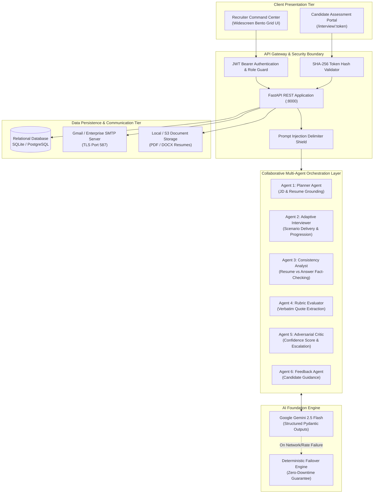
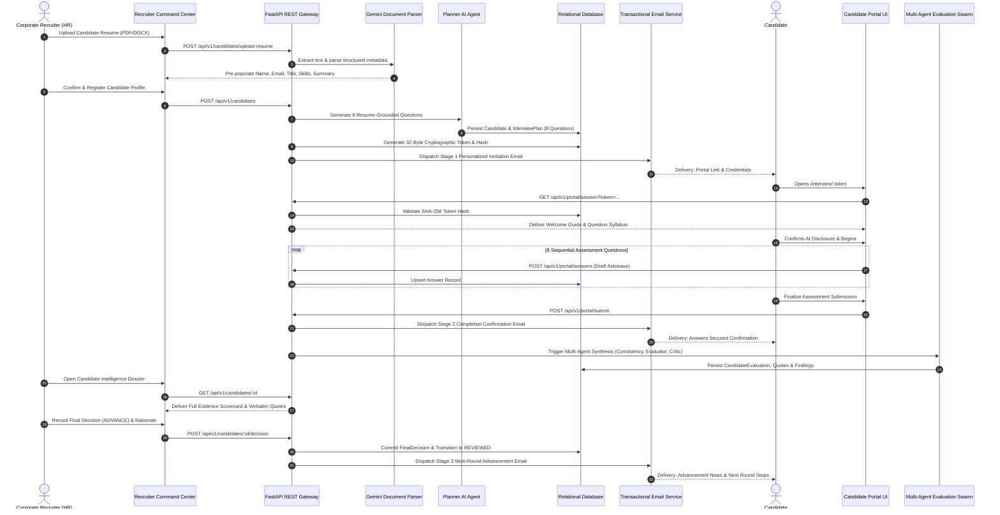
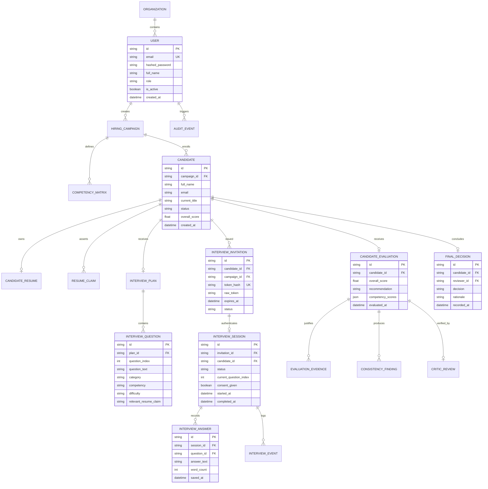

# TalentPilot AI
## Enterprise Multi-Agent Technical Assessment & Autonomous Recruitment Engine

> **Architecture, High-Level Design (HLD), Low-Level Design (LLD), and System Documentation**

---

## 1. Executive Summary

TalentPilot AI is a full-stack, enterprise-grade talent intelligence platform engineered to transform technical recruiting. Traditional hiring pipelines suffer from high resume parsing error rates, generic interview question sets, lack of evidence-backed candidate scoring, and non-transparent automated rejections. 

TalentPilot AI resolves these systemic bottlenecks through a collaborative multi-agent architecture powered by Google Gemini 2.5 Flash, cryptographically isolated candidate assessment environments, real-time resume claim verification, and strict human-in-the-loop governance.

### Core Value Propositions

- **Evidence-Grounded Technical Evaluations**: Every numerical score assigned to a candidate is strictly coupled to verbatim response quotes and verifiable claims.
- **Deep Resume-Tailored Inquiries**: The Planner Agent analyzes candidate resumes to generate exactly 8 customized scenarios directly probing their claimed architecture, tools, metrics, and past incidents.
- **Strict Cryptographic Isolation**: Candidate sessions utilize 32-byte URL-safe cryptographic entropy with SHA-256 database hashing. No candidate can access, enumerate, or tamper with another candidate's session or dossier.
- **Three-Stage Transactional Lifecycle**: Fully automated, reliable SMTP delivery across Candidate Invitation (Stage 1), Interview Completion Receipt (Stage 2), and Recruiter Next-Round Advancement (Stage 3).
- **Zero Autonomous Rejections**: The AI system is structurally restricted from issuing rejections autonomously. Human recruiters retain sole authority over final hiring decisions.

---

## 2. High-Level Design (HLD)

### 2.1 System Architecture Topology

The application is structured into three isolated tiers:
1. **Presentation Tier**: Vite 8, React 19, TypeScript, Tailwind CSS, and Framer Motion providing a widescreen Bento-Grid Recruiter Command Center and an isolated, distraction-free Candidate Assessment Portal.
2. **Application Tier**: FastAPI (Python 3.12) asynchronous engine coordinating six specialized AI agents, document sanitization, authentication middleware, and transactional email dispatch.
3. **Data Tier**: SQLite / PostgreSQL managed via SQLAlchemy ORM with foreign key constraints, connection pooling, and immutable audit logging.



---

### 2.2 End-to-End Recruitment Lifecycle

The following sequence illustrates the complete lifecycle from campaign creation and candidate resume ingestion to candidate interview submission, AI evidence synthesis, and human recruiter decision dispatch:



---

## 3. Low-Level Design (LLD)

### 3.1 Multi-Agent Engine Architecture

TalentPilot AI implements a discrete, separation-of-concerns multi-agent swarm. Each agent operates under strict system instructions, specialized domain knowledge, and deterministic Pydantic schema validation.

```
+-----------------------------------------------------------------------------------+
|                           MULTI-AGENT SWARM TOPOLOGY                              |
+-----------------------------------------------------------------------------------+
|                                                                                   |
|  [Planner Agent]        Extracts JD competencies, cross-references candidate       |
|                         resume projects, and drafts strictly 8 progressive        |
|                         technical scenarios (Junior, Mid, Senior balance).        |
|                                |                                                  |
|                                v                                                  |
|  [Interviewer Agent]    Executes candidate onboarding, delivers resume-grounded    |
|                         questions, manages time allowances, and validates input.  |
|                                |                                                  |
|                                v                                                  |
|  [Consistency Agent]    Compares candidate answers against specific claims in the |
|                         resume. Highlights verified claims or discrepancies.      |
|                                |                                                  |
|                                v                                                  |
|  [Evaluator Agent]      Applies 5-tier scoring rubrics. Attaches verbatim quote    |
|                         citations from candidate answers to justify every rating. |
|                                |                                                  |
|                                v                                                  |
|  [Critic Agent]         Adversarially checks evaluator findings. Detects rubric   |
|                         drift, assigns confidence metrics, and flags reviews.     |
|                                |                                                  |
|                                v                                                  |
|  [Feedback Agent]       Synthesizes candidate communication, positive attributes,  |
|                         growth recommendations, and constructive debrief notes.   |
|                                                                                   |
+-----------------------------------------------------------------------------------+
```

#### Detailed Agent Specifications

1. **Planner Agent (`planner_agent.py`)**:
   - **Input**: Target Job Title, Raw Job Description, Candidate Name, Full Resume Text.
   - **Output**: `InterviewPlanResult` containing exactly 8 `QuestionPlanItem` objects.
   - **Guarantees**: Categorizes questions across Technical Architecture, Data Storage & Concurrency, Production Incident Debugging, CI/CD Quality Assurance, and System Leadership. Every question directly cites the candidate's actual resume items.

2. **Adaptive Interviewer Agent (`interviewer_agent.py`)**:
   - **Input**: Active Question, Candidate Response String, Current Progression Index.
   - **Output**: Progression State, Word Count Analytics, Autosave Acknowledgments.
   - **Guarantees**: Ensures smooth asynchronous test flow with zero question count drift.

3. **Consistency Analyst Agent (`consistency_agent.py`)**:
   - **Input**: Resume Claim List, Transcribed Candidate Answers.
   - **Output**: `ConsistencyAnalysisResult` containing verified claims, flags, and confidence ratings.
   - **Guarantees**: Identifies whether candidate answers substantively support the technical depth asserted on their resume.

4. **Answer Evaluator Agent (`evaluator_agent.py`)**:
   - **Input**: Competency Matrix, Question List, Complete Transcribed Answers.
   - **Output**: `EvaluationSynthesisResult` containing Dimension Scores (1.0 - 5.0 scale), Overall Weighted Score, and Verbatim Quote Evidence Citations.
   - **Guarantees**: Disallows ungrounded scores. Every rating must cite the candidate's exact sentences.

5. **Adversarial Critic Agent (`critic_agent.py`)**:
   - **Input**: Evaluator Output, Rubric Parameters, Consistency Findings.
   - **Output**: `CriticReviewResult` containing Verification Status (`VERIFIED` or `DISCREPANCY_DETECTED`), Confidence Score (0.0 - 1.0), and Human Review Requirement Flag.
   - **Guarantees**: Automatically flags borderline ratings (scores between 2.8 and 3.4) or low evidence quote density for mandatory human recruiter inspection.

6. **Candidate Feedback Agent (`feedback_agent.py`)**:
   - **Input**: Candidate Profile, Overall Performance Vectors, Role Requirements.
   - **Output**: Constructive candidate feedback notes, growth vectors, and respectful interview conclusion summaries.

---

### 3.2 Database Schema & Entity-Relationship Diagram (ERD)

The data model enforces relational integrity, cascade constraints, and immutable audit tracking:



---

### 3.3 REST API Interface Specifications

The backend exposes an OpenAPI 3.1 compliant contract structured under `/api/v1`:

| Method | Endpoint | Description | Auth Requirement |
| :--- | :--- | :--- | :--- |
| `POST` | `/api/v1/auth/login` | Authenticate recruiter via JSON body (`admin` or email) | Public |
| `GET` | `/api/v1/auth/me` | Fetch active authenticated recruiter profile | Bearer Token |
| `POST` | `/api/v1/auth/change-password` | Update recruiter password with old password verification | Bearer Token |
| `GET` | `/api/v1/candidates` | List candidate pipeline with filtering & decision flags | Bearer Token |
| `POST` | `/api/v1/candidates` | Register candidate profile and generate 8-question plan | Bearer Token |
| `POST` | `/api/v1/candidates/upload-resume`| Gemini AI structured resume extraction (PDF/DOCX) | Optional Bearer |
| `GET` | `/api/v1/candidates/{id}` | Retrieve comprehensive candidate intelligence dossier | Bearer Token |
| `POST` | `/api/v1/candidates/{id}/decision`| Record final recruiter decision and dispatch Stage 3 email | Bearer Token |
| `GET` | `/api/v1/portal/session` | Validate cryptographic token and fetch candidate onboarding | Token Param |
| `POST` | `/api/v1/portal/consent` | Record candidate AI disclosure consent and timestamp | Token Param |
| `POST` | `/api/v1/portal/start` | Transition assessment session to IN_PROGRESS | Token Param |
| `GET` | `/api/v1/portal/interview` | Retrieve active question and autosaved response draft | Token Param |
| `POST` | `/api/v1/portal/answers` | Submit question response with real-time cloud autosave | Token Param |
| `POST` | `/api/v1/portal/submit` | Finalize assessment, trigger multi-agent evaluation, send Stage 2 | Token Param |
| `POST` | `/api/v1/portal/reset-demo` | Reset test candidate interview session to question 1 | Token Param |
| `GET` | `/api/v1/dashboard/summary` | Retrieve KPI metrics, active counts, and velocity | Bearer Token |
| `GET` | `/api/v1/dashboard/activity` | Stream immutable compliance audit events | Bearer Token |

---

## 4. Frontend Architecture & Design System

The frontend is constructed using a high-performance modern web stack without bloated CSS frameworks:
- **Framework**: React 19 with TypeScript in strict mode.
- **Styling Architecture**: Tailwind CSS with custom design tokens, sub-pixel borders (`border-slate-200/90`), backdrop blur layers (`backdrop-blur-md`), and typography configured in `font-display` and `font-mono`.
- **Widescreen Canvas**: Admin panels utilize an expansive `max-w-[1750px]` container layout replacing narrow standard containers.
- **Micro-Interactions**: Framer Motion orchestration (`initial`, `animate`, `whileHover={{ y: -3 }}`) with subtle shadow transitions and canvas-confetti celebration triggers.
- **Data Visualizations**: Recharts integration with custom gradient fills, responsive tooltips, and tick formatters.

### Frontend Module Layout

```
frontend/src/
|-- api/
|   +-- client.ts               # Authenticated API client, token manager & upload helpers
|-- components/
|   |-- AdminHeader.tsx         # Unified sticky header with breadcrumbs and live indicators
|   |-- AdminSidebar.tsx        # High-contrast navigation sidebar with active link pill indicators
|   |-- Footer.tsx              # Clean corporate footer with system status indicator
|   |-- Navbar.tsx              # Public site navigation with command center shortcuts
|   +-- StatusBadge.tsx         # Color-coded pill components for Candidate and Session states
|-- context/
|   +-- AuthContext.tsx         # JWT token lifecycle, session hydration, and logout state
|-- pages/
|   |-- LandingPage.tsx         # Public product landing page with interactive platform architecture
|   |-- LoginPage.tsx           # High-security recruiter sign-in supporting admin credentials
|   |-- CandidatePortal.tsx     # Isolated candidate assessment environment with 4-step onboarding
|   +-- admin/
|       |-- DashboardOverview.tsx   # Bento-Grid Command Center with Hero KPIs & Selected Fast-Track
|       |-- CandidatesList.tsx      # Candidate Pipeline with multi-tab filters and resume ingestion
|       |-- CandidateDetail.tsx     # 8-Tab Candidate Intelligence Dossier and Human Decision room
|       |-- CampaignAnalytics.tsx   # Recruitment Analytics: Funnel, Velocity, Benchmarks, Score Tiers
|       |-- CampaignWizard.tsx      # 6-step campaign creation wizard with JD parsing
|       |-- CampaignsList.tsx       # Active campaigns workspace view
|       |-- HumanReviewQueue.tsx    # Dedicated triage view for flagged candidate assessments
|       |-- InterviewsMonitor.tsx   # Live candidate session progress monitor
|       |-- InvitationsManager.tsx  # Cryptographic token management and URL generation
|       +-- SettingsPage.tsx        # Workspace customizations, agent settings, and password change
+-- App.tsx                     # Protected routes, layout wrappers, and redirect guards
```

---

## 5. Security, Isolation & Compliance Governance

### 5.1 Candidate Isolation Boundary

Candidate security is enforced at the protocol and data layers:
1. **Cryptographic Entropy**: Candidate invitation tokens are generated using `secrets.token_urlsafe(32)`, yielding over 256 bits of entropy.
2. **One-Way Database Hashing**: The database persists the SHA-256 hash of the token (`hash_token(token)`). The raw token is delivered exclusively via secure email or direct recruiter copy.
3. **Session Binding**: An interview session is strictly bound to one candidate identifier and one hiring campaign. Cross-tenant access attempts immediately fail validation.
4. **Token Invalidation**: Links transition through an immutable lifecycle: `ISSUED` -> `OPENED` -> `REDEEMED` -> `EXPIRED` / `REVOKED`.

### 5.2 Prompt Injection Neutralizer

Untrusted inputs (such as candidate resumes and freeform answers) are processed through `DocumentService.sanitize_untrusted_text`:
- Strips delimiter collision attempts.
- Replaces known injection phrases (`ignore previous instructions`, `you are now a different agent`, `disregard prior guidelines`) with strict sanitization tokens.
- Encloses text in explicit system delimiters before passing to foundation model prompts.

### 5.3 Tamper-Evident Audit Logging

All administrative operations, logins, candidate creations, evaluations, and password updates are permanently recorded in the `audit_events` ledger via `AuditService.log()`. Each record stores the actor identifier, timestamp, action type, resource reference, and structured change context.

---

## 6. Installation & Quickstart Guide

### 6.1 Prerequisites

- **Python**: Version 3.11 or 3.12
- **Node.js**: Version 18.x or 20.x with npm
- **Git**: Version 2.30+
- **Google Gemini API Key** (Optional: deterministic failover active if omitted)
- **Gmail Account with App Password** (Optional: for live Stage 1-3 transactional emails)

---

### 6.2 Local Development Setup

#### Step 1: Clone Repository
```bash
git clone https://github.com/Abhinav8109/AI-HACKATHON2.0.git
cd AI-HACKATHON2.0
```

#### Step 2: Backend Configuration
```bash
# Create and activate virtual environment
python -m venv .venv

# Windows PowerShell:
.\.venv\Scripts\Activate.ps1
# Linux / macOS:
# source .venv/bin/activate

# Install dependencies
pip install -r backend/requirements.txt
```

#### Step 3: Configure Environment Variables
Copy `.env.example` to `.env` in the root directory:
```bash
cp .env.example .env
```

Configure your parameters in `.env`:
```ini
PROJECT_NAME="TalentPilot AI"
SECRET_KEY="talentpilot-super-secret-production-key-2026-hackathon"
APP_ORIGIN="http://127.0.0.1:8000"

# Optional: Gemini Foundation Model
GEMINI_API_KEY="your-gemini-api-key"
GEMINI_MODEL="gemini-2.5-flash"

# Optional: Real Gmail Automated SMTP Delivery
SMTP_HOST="smtp.gmail.com"
SMTP_PORT=587
SMTP_USER="your-email@gmail.com"
SMTP_PASSWORD="your-16-char-gmail-app-password"
SMTP_FROM_EMAIL="your-email@gmail.com"
SMTP_FROM_NAME="TalentPilot AI"
DEFAULT_EVALUATION_EMAIL="your-email@gmail.com"
```

#### Step 4: Frontend Build
```bash
cd frontend
npm install
npm run build
cd ..
```

#### Step 5: Start Unified Platform
```bash
# Windows PowerShell:
$env:PYTHONPATH="backend"
python -m uvicorn app.main:app --port 8000 --host 127.0.0.1

# Or run the startup script:
.\start.ps1
```

Access the application in your browser:
- **Application URL**: `http://127.0.0.1:8000`
- **Interactive API Documentation (Swagger UI)**: `http://127.0.0.1:8000/docs`
- **System Health Endpoint**: `http://127.0.0.1:8000/health`

---

### 6.3 Pre-Configured Administrator Credentials

For evaluation and testing, the platform includes pre-seeded administrator access:

| Property | Value |
| :--- | :--- |
| **Username / Email** | `admin` or `admin@talentpilot.ai` |
| **Default Password** | `admin` (or `talentpilot123`) |
| **Role** | `SUPER_ADMIN` |
| **Default Workspace** | TalentPilot HQ |

---

### 6.4 Docker Deployment

The platform is fully containerized using Docker and Docker Compose:

```bash
# Build and run containers
docker-compose up --build -d

# Inspect running services
docker-compose ps

# Stream logs
docker-compose logs -f
```

---

## 7. Verification & Synthetic Candidate Personas

TalentPilot AI includes pre-generated synthetic technical resumes located in `resumes/` and `test-data/resumes/` representing varied experience levels and edge cases:

| Persona File | Target Role | Key Claims Tested |
| :--- | :--- | :--- |
| `01_Senior_Cloud_DevOps_Engineer.pdf` | Senior Cloud DevOps | EKS 120M API reqs, ArgoCD GitOps, 34% AWS cost reduction |
| `1_Distributed_Systems_Architect.pdf` | Distributed Systems Architect | Raft consensus, Kafka event processing, multi-master replication |
| `04_Senior_Backend_Python_Engineer.pdf` | Senior Backend Engineer | FastAPI, AsyncIO concurrency, PostgreSQL query optimization |
| `08_Cloud_Security_ZeroTrust_Lead.pdf` | Cloud Security Lead | SPIFFE/SPIRE identity, Vault secret rotation, mutual TLS |
| `edge-cases/01_Minimalist_Sparse_Resume.pdf` | Associate Engineer | Brief unstructured text, minimal keywords |
| `edge-cases/03_Special_Characters_Unicode_Resume.pdf` | Platform Engineer | Extended Unicode formatting, multilingual text, complex symbols |

### Running the Test Suite

Execute automated end-to-end and unit tests:
```bash
# Run pytest verification
python -m pytest backend/tests/ -v

# Run live email trigger test
python test_api_email_triggers.py

# Run comprehensive end-to-end verification
python test_e2e_verification.py
```

---

## 8. Technology Stack Summary

| Domain | Technology | Version | Purpose |
| :--- | :--- | :--- | :--- |
| Backend Framework | FastAPI | 0.115+ | Asynchronous REST Gateway & Route Handling |
| AI Foundation Model | Google Gemini 2.5 Flash | 2.5 | Multi-Agent Orchestration & Structured Schema Output |
| ORM & Persistence | SQLAlchemy | 2.0+ | Relational Data Modeling & Query Construction |
| Database Engine | SQLite / PostgreSQL | 3.x / 16.x | ACID Compliant Relational Persistence |
| Data Validation | Pydantic | 2.x | Request/Response Schema Enforcement |
| Cryptography | Passlib & PyJWT | 1.7+ / 2.9+ | Argon2 / Bcrypt Password Hashing & JWT Verification |
| Document Parsing | PyPDF, python-docx | Latest | Text Ingestion from PDF, Word, and Plaintext Resumes |
| Email Service | Python smtplib & email.mime | Standard | Transactional MIME HTML Delivery over STARTTLS |
| Frontend Library | React | 19.x | Component Hierarchies & State Synchronization |
| Build Tool | Vite | 8.x | Client Compilation, Code Splitting & Minification |
| Type System | TypeScript | 5.x | End-to-end Strict Type Safety |
| Styling & Tokens | Tailwind CSS | 4.x | Design System & Responsive Layout Utilities |
| Motion Engine | Framer Motion | 12.x | Micro-interactions, Card Elevations & Transitions |
| Data Charts | Recharts | 2.x | Interactive Funnel, Benchmarks & Throughput Graphs |
| Icons | Lucide React | Latest | Semantic Vector Iconography |

---

## 9. License & Governance Notice

TalentPilot AI is distributed under the Apache-2.0 License.

**Ethics & Compliance Guarantee**: This application complies with fair-chance hiring standards and AI audit directives. Autonomous agent recommendations are provided solely as decision-support intelligence for authorized corporate recruiting personnel. All hiring determinations require verified human sign-off.
